# Architecture

## 1. Overview

`doc-sync` is a Python command-line application that gathers repository facts,
renders a stable Markdown document, and writes `docs/PROJECT_DOC.md`. A local
repository is read from disk; a GitHub repository is read through the GitHub
REST API. A GitHub Actions workflow runs the local-repository mode on pushes
to `main` and commits the output only when it differs from the checked-in
document.

## 2. Components

### 2.1 CLI and Input Validation

The CLI accepts a local directory or a GitHub repository in `owner/name`
form. It validates the input before scanning. Invalid or missing local paths
and invalid repository identifiers produce a concise error and non-zero exit
status.

### 2.2 Repository Scanners

- The local scanner reads repository files and Git metadata without including
  absolute local paths in output.
- The GitHub scanner uses the GitHub API to obtain repository metadata,
  relevant file contents, a file inventory, and the latest commit. It reads a
  token only from the configured environment variable when present.
- Both scanners provide the renderer with the same normalized repository
  facts so document formatting is independent of the source.

### 2.3 Documentation Renderer and Writer

The renderer maps normalized facts to the seven required sections, in order:
Name, Description, Languages, Dependencies, Entry Points, How to Run, and
Last Commit. It uses `Not Found` for missing values and emits no guessed
metadata, secrets, or absolute local paths. Stable ordering and formatting
make unchanged inputs produce identical output.

The writer creates the `docs` directory when needed and updates
`docs/PROJECT_DOC.md` under the current working directory by default. An
explicit output path can override the default. Writing the same rendered
content twice has no observable content difference.

### 2.4 GitHub Actions

The workflow triggers on pushes to `main`, checks out the repository, sets up
Python 3.11, installs project dependencies, and runs `doc-sync` against the
checked-out repository. It stages and commits `docs/PROJECT_DOC.md` only when
that file has changed. The workflow token is provided through the Actions
environment rather than embedded in source or generated documentation.

## 3. Data Flow

1. The CLI parses and validates the input.
2. The matching scanner gathers source-independent repository facts.
3. The renderer produces the required deterministic Markdown.
4. The writer stores the document under the current working directory by
   default for either input source; an explicit output path can override it.
   The GitHub Action uses local mode on the checked-out repository so the
   result can be committed.
5. On GitHub API failures, the CLI reports a sanitized error and exits
   non-zero rather than writing a success-shaped document.

## 4. Data and Detection Rules

- Description: first non-empty paragraph from a supported README.
- Dependencies: `requirements.txt` only.
- Entry points: recognized common scripts and declared packaging entry points
  from `pyproject.toml` and `setup.cfg`.
- Languages: determined from recognized source-file extensions, with stable
  ordering.
- Last Commit: the latest commit identifier available for the source.
- Missing section values: exactly `Not Found`.
- GitHub input: `owner/name`; credentials are sourced only from an
  environment variable and never included in output or error text.

## 5. Error Handling and Security

- Validate local paths and GitHub repository identifiers before scanning.
- Bound GitHub network requests with timeouts and report HTTP, rate-limit,
  timeout, and response-format failures clearly.
- Do not print request headers, tokens, passwords, or raw response data in
  logs or user-facing errors.
- Do not put absolute local paths in the generated document.
- For a valid but empty local repository, generate all seven sections with
  `Not Found`; distinguish this from an invalid path.

## 6. Quality Attributes

- Determinism: stable section order, sorted detected values, and no
  timestamps or machine-specific paths in output.
- Performance: local scanning should complete in under 10 seconds for a
  repository with fewer than 1,000 files.
- Maintainability: scanners, rendering, writing, and CLI error handling have
  separate responsibilities.
- Testability: scanners and renderer can be tested using temporary
  repositories and mocked GitHub responses without real credentials.

## 7. Requirement Traceability

| Requirement | Architectural support |
| --- | --- |
| FR-1 to FR-2 | CLI validation and local/GitHub scanners |
| FR-3 to FR-8 | Renderer and local scanner |
| FR-9 to FR-10 | CLI validation and bounded GitHub API handling |
| FR-11 to FR-12 | Environment-only credentials and sanitized output |
| FR-13 | Stable scanner facts and deterministic renderer |
| FR-14 | Push workflow with change-conditional commit |
| NFR-1 to NFR-4 | Python 3.11 workflow, efficient scanning, focused tests |

## 8. Agent Orchestrator Architecture

### 8.1 Overview

A workspace Copilot orchestrator coordinates the existing project agents
without changing the `doc-sync` CLI. It accepts a user story and requirement
text, delegates each stage sequentially, and uses workflow-specific
documentation artifacts as durable handoff inputs. Each run gets a unique,
sanitized directory under `docs/workflows/` so it does not overwrite project
documentation or artifacts from another run. The orchestrator pauses for user
approval before file changes and before each implementation task.

### 8.2 Components

| Component | Responsibility | Inputs | Outputs |
| --- | --- | --- | --- |
| Orchestrator agent (`.github/agents/orchestrator.agent.md`) | Validate workflow inputs, assign a unique workflow directory, dispatch one stage at a time, request approvals, check outputs and dependencies, and stop on failure. | User story, requirement text, existing artifacts and plan status. | A sequential delegation request with the relevant input artifacts; a clear completion or stop report. |
| Specialist agents | Perform requirements, architecture, design review, planning, implementation, code review, and verification within their current roles. | Explicit task context and relevant named artifacts. | Their designated artifact or implementation result. |
| Workflow artifacts (`docs/workflows/<workflow-id>/`) | Persist and expose approved stage outputs for later agents without replacing project-level docs or other run outputs. | Approved agent outputs. | `requirements.md`, `architecture.md`, `design-review.md`, `impl-plan.md`, implementation changes, `code-review.md`, `verification-report.md`, and `pr-description.md`. |
| PR writer agent (`.github/agents/pr-writer.agent.md`) | Prepare factual PR metadata, then commit approved changes, push the feature branch, and create or update its PR after verification and user approval. | Workflow artifacts, changed-file list, Git status/history, and verification evidence. | `pr-description.md`, a commit and pushed branch, and a PR URL. |
| Copilot agent delegation | Run one named specialist stage at a time and return its result to the orchestrator. | Self-contained prompt with stage, inputs, constraints, and expected output. | Specialist response available to the orchestrator for validation and handoff. |

The orchestrator uses Copilot's native agent delegation rather than Local
harness handoff configuration. It creates a unique workflow ID from a
sanitized story title and a collision-resistant suffix, then passes the
resulting artifact directory to every specialist. its own tool access should
be limited to delegation, artifact inspection, and recording user-approved
review decisions; it does not run project commands. The PR writer alone
performs the approved Git/GitHub publication actions after verification.
Existing specialist tool
declarations and prompts shall be updated to Copilot-supported tools and the
workflow artifact directory where required, without changing their
responsibilities.

### 8.3 Component Diagram

```mermaid
flowchart LR
    U[User story and requirement] --> O[Orchestrator]
    O --> A[Analyst]
    A --> R[requirements.md]
    R --> AR[Architect]
    AR --> ARCH[architecture.md]
    ARCH --> DR[Design reviewer]
    DR --> DREV[design-review.md]
    DREV --> P[Planner]
    R --> P
    ARCH --> P
    P --> PLAN[impl-plan.md]
    PLAN --> DEV[Developer, one approved task at a time]
    DEV --> CHG[Implementation changes]
    CHG --> CR[Code reviewer]
    CR --> CREV[code-review.md]
    CREV --> T[Tester]
    T --> VR[verification-report.md]
    VR --> PR[PR writer]
    PR --> COMMIT[Approved commit]
    COMMIT --> PUSH[Push feature branch]
    PUSH --> PULL[Create or update pull request]
    O -. approvals and stage checks .-> U
```

### 8.4 Data Flow

1. The user supplies both the user story and requirement text. The
   orchestrator checks that both are present and asks the user to approve
   each stage's file changes.
2. The analyst receives both inputs and produces the requirements artifact.
   The orchestrator confirms that the artifact exists before dispatching the
   architect with the approved requirements.
3. The architect produces the architecture artifact. The design reviewer
   receives the requirements and architecture and returns its review in chat;
   the orchestrator presents findings for the user's Accept, Reject, or Defer
   decisions and records the approved review in the workflow directory's
   `design-review.md`.
4. The planner receives the requirements, architecture, and design-review
   decisions, then produces the implementation plan.
5. The orchestrator reads the plan, verifies dependencies, and processes
   every task in dependency order. Before each task it presents the
   developer's task-specific plan and waits for user approval. It dispatches
   the developer for only that task and checks that the task is marked Done
   before proceeding.
6. After all plan tasks are complete, the code reviewer checks the changes.
   The orchestrator presents findings for user decisions and records the
   resulting review in the workflow directory's `code-review.md`.
7. The tester receives the approved requirements, implementation plan,
   implementation results, and code-review decisions. It runs verification
   and produces `verification-report.md` in the workflow directory.
8. Only after verification succeeds, the PR writer gathers the actual
   changed-file list and test evidence, prepares a workflow-specific
   `pr-description.md`, and presents the proposed commit, push, and PR actions
   for explicit user approval. It stages only approved changes, verifies
   that the current branch is not the base branch and that no unrelated or
   unapproved work is present, then commits and pushes. It updates an
   existing open PR for the same head/base when possible; otherwise it creates
   one against `main`. It never merges.
9. If a delegated stage fails, a required artifact is absent, a review
   decision is unresolved, or a task's dependency is incomplete, the
   orchestrator stops and reports the blocking stage or task. It does not
   dispatch dependent work.

### 8.5 Technology Choices

| Choice | Reason | Alternative considered |
| --- | --- | --- |
| Workspace Copilot custom agent | Makes the coordinator reusable in VS Code and keeps this feature out of the documentation CLI. | A Python orchestration service would add runtime and dependency complexity and would not directly coordinate VS Code agents. |
| Copilot native agent delegation | Returns specialist results to the orchestrator so it can validate and pass forward explicit context. | Local-only handoff configuration is not the Copilot harness delegation mechanism. |
| Existing Markdown artifacts as handoff records | Gives each stage a reviewable, persistent input and output and avoids re-entering agent responses. | Passing only chat summaries risks losing details and is not durable across stages. |
| Copilot-supported tool declarations for specialist agents | Enables their existing roles to run under the selected Copilot harness. | Keeping incompatible tool names could prevent agents from editing, reading, or testing as intended. |

### 8.6 Requirement Traceability

| Requirement | Architectural support |
| --- | --- |
| FR-15 to FR-17 | Orchestrator inputs, sequential delegation, and named artifacts |
| FR-18 | Planner handoff includes requirements, architecture, and design review |
| FR-19 | Dependency-ordered developer loop, one approved task per invocation |
| FR-20 | Orchestrator approval checkpoints before writes and implementation tasks |
| FR-21 | Code review follows implementation; tester follows review |
| FR-22 | Required-output and dependency checks stop downstream dispatch |
| FR-23 | Tester creates the verification report |
| FR-24 | Unique sanitized workflow directory prevents output collisions |
| FR-25 to FR-27 | Approval-gated PR writer checks, commits, pushes, and creates/updates without merging |
| NFR-5 to NFR-7 | Existing roles, durable sequential handoffs, and inherited security rules |

### 8.7 Error Handling, Security, and Risks

- Each delegation prompt identifies its inputs, expected output, and allowed
  work. The orchestrator checks for the required output before continuing.
- Agent failures and missing outputs are reported directly; they are not
  replaced with success-shaped summaries.
- Secrets are not included in delegated prompts or artifacts. Existing
  project rules for credentials and generated documentation remain in force.
- Tool names differ by Copilot harness. The specialist agent declarations
  must be verified in the target VS Code Copilot session; editor schema
  validation alone does not confirm runtime behavior.
- Delegated agents may return a result without writing the expected artifact.
  The orchestrator must treat that as a blocked stage and ask for resolution,
  not silently create or infer the missing output.
- Git publication is an external side effect. Require explicit approval for
  commit, push, and PR creation/update, use only the feature branch, stop on
  unapproved work or failed verification, and never merge automatically.
