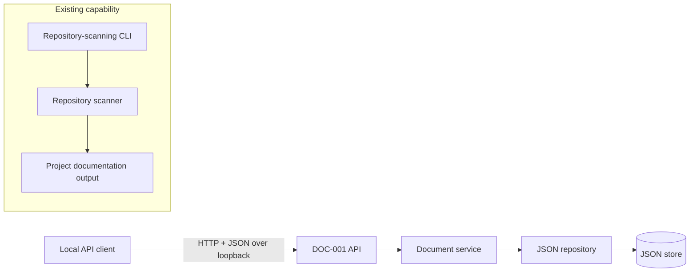
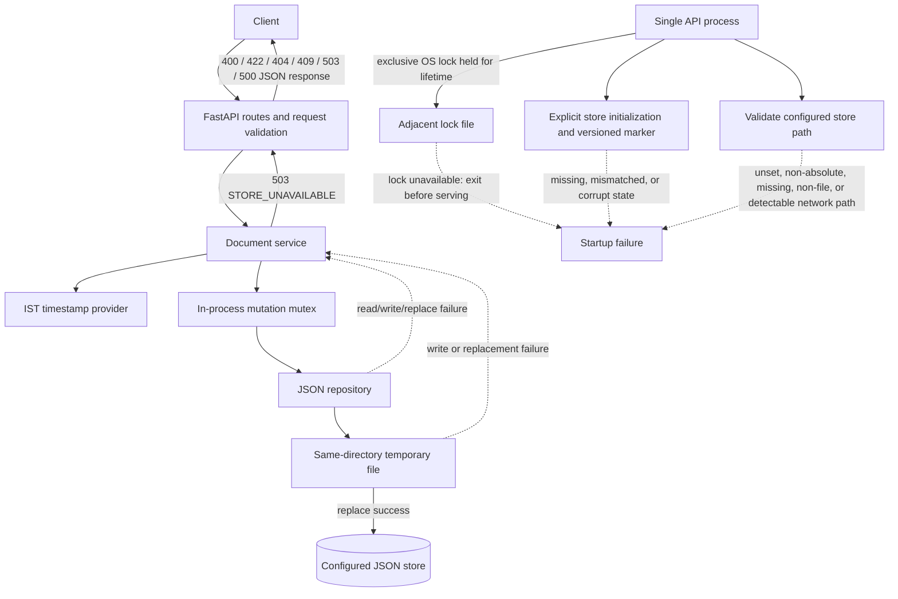

# Approved Architecture — DOC-001: Document Version Tracker

**Revision status:** Approved with Conditions following R3; stakeholder dispositions were recorded on 2026-11-19. Implementation verification remains pending.  
**Reviews:** `DOC-001-DR-R2` outcome **Changes Required**; `DOC-001-DR-R3` outcome **Approved with Conditions**.  
**Requirements:** Approved by the user; see [requirements.md](./requirements.md).  
**Approved decisions:** API delivery, JSON persistence, the API/runtime contract below, version-history behavior, IST timestamps, validation rules, store lifecycle, local-filesystem ownership, TASK-005 storage-path validation policy B, and error mappings.  
**Review independence:** The R3 outcome is preserved. The stakeholder dispositions below are not represented as a new independent design review.

## 1. Overview and Architecture Drivers

The DOC-001 capability is a local HTTP API backed by a JSON store. Its API, document service, timestamp handling, and persistence are separate from the existing repository-scanning CLI and GitHub integration.

The main drivers are:

- Create documents at version 1; increment versions on accepted content updates (FR-001–FR-003).
- Record accepted content-update timestamps in IST and return newest-first history (FR-004–FR-005).
- Reject empty content with a validation message (FR-006).
- Preserve the user-approved API and JSON choices while defining deterministic behavior and safe store lifecycle rules.
- Keep the service loopback-only unless scope and security are explicitly changed.

No performance, availability, recovery-time, retention, or capacity targets are specified.

## 2. Context and High-Level Architecture



The API adds document tracking only. It does not integrate with, replace, or change the existing scanner.



## 3. Components and Responsibilities

| Component | Responsibility |
|---|---|
| HTTP/API layer | Parse requests, validate API shape, return the defined HTTP/JSON contract |
| Request validation | Reject malformed fields, empty or whitespace-only titles, and empty or whitespace-only content |
| Document service | Create version 1, check document existence and expected version, append accepted content changes |
| Timestamp provider | Produce a timezone-aware IST timestamp |
| JSON repository | Validate the store, construct candidate state, and persist it using replacement |
| Process ownership | Acquire an OS-level exclusive lock before serving and serialize in-process mutations |
| Existing repository scanner | Continue independently |

## 4. Approved API Contract

The API uses REST-style HTTP with JSON. It does not add title updates, deletion, restoration, comparison, sharing, or authentication.

| Operation | Request | Success |
|---|---|---|
| `POST /api/v1/documents` | `{"title": string, "content": string}` | `201 Created`; document ID, title, current version `1` |
| `PUT /api/v1/documents/{document_id}/content` | `{"content": string, "expected_version": integer}` | `200 OK`; ID, `changed`, current version, `updated_at` |
| `GET /api/v1/documents/{document_id}/versions` | No body | `200 OK`; version number and timestamp entries in descending version order |

A server-generated UUID identifies a document. `expected_version` is required for content updates; a stale value returns `409 VERSION_CONFLICT` without a change. It does not provide multi-process consistency.

Confirmed deterministic behavior:

- Malformed JSON: `400 INVALID_JSON`.
- Invalid shape, missing fields, wrong types, extra fields, invalid ID syntax, or invalid `expected_version`: `422 VALIDATION_ERROR`.
- Empty or whitespace-only title: `422 VALIDATION_ERROR`, message `Title must not be empty.`
- Empty or whitespace-only content on creation or update: `422 VALIDATION_ERROR`, message `Content must not be empty.`
- Other submitted content is stored without trimming.
- For a structurally valid update, check document existence before comparing `expected_version`: a nonexistent document returns `404 DOCUMENT_NOT_FOUND`.
- `expected_version` is required. If it differs from the current version, return `409 VERSION_CONFLICT` and make no change.
- Submitting content identical to the current content is a no-op: `200`, `changed: false`, unchanged version, and `updated_at: null`. It does not append a version or claim an update timestamp.
- A changed content update returns `200`, `changed: true`, the incremented version, and the new update timestamp.
- An invalid request never changes state.
- Missing, corrupt, or mismatched store/marker state fails closed at startup; store read, write, or replacement failures return `503 STORE_UNAVAILABLE` when the API is running.
- Unexpected failures return `500 INTERNAL_ERROR` with a generic message.

Errors use the JSON envelope `{"error":{"code":"...","message":"..."}}`. Error details must not disclose document content, filesystem paths, stack traces, or secrets. Automatic write retries are not used.

## 5. Data and Persistence Architecture

JSON persistence is **Approved**.

The JSON store has documents keyed by ID. A document has a title, current version, and version entries containing a version number, content snapshot, and timestamp. Version 1's timestamp records creation time; subsequent timestamps record accepted content updates. Timestamps are timezone-aware IST and are displayed in ISO 8601 form with `+05:30`. History is returned newest-first and exposes only each version number and timestamp; previous content snapshots are retained but are not returned by the history endpoint.

Titles are immutable after creation. No title-update endpoint is provided. Snapshots are retained without automatic pruning; no restore or comparison operation is included.

### Safe initialization, deletion, and corruption policy

- **TASK-005 storage-scope policy (B — Approved):** `DOC_SYNC_STORE_PATH` must be configured by the operator with an absolute local filesystem path. The supported storage scope is the local filesystem.
- Startup must reject the configured path when `DOC_SYNC_STORE_PATH` is unset, the path is not absolute, the path is missing or is not a regular file, or the path is a known/detectable UNC or remote/network path. The startup failure must be fail-closed and must not silently initialize or accept the store.
- Detectable network/remote paths include, at minimum, OS-recognized UNC and remote storage locations. Detection is platform and capability dependent; a mounted network filesystem that cannot be reliably identified by the implementation is unsupported by the approved scope but may not be automatically detectable. It must not be claimed or represented as detected.
- Operators must configure local storage explicitly. Mounted network filesystems remain an operational limitation: they are not supported, and unknown mounted network storage cannot be guaranteed to be rejected. This limitation must be visible in startup documentation and failure handling.
- File access relies on the operating-system account's permissions. This policy does not claim protection against all network mounts or storage devices that cannot be reliably classified.
- Normal API startup **never creates an absent store**. An absent configured store causes startup to fail closed; if detected while running, store-dependent operations return 503.
- First use requires a separate explicit initialization action. It creates an empty store only if neither the store nor initialization marker exists; normal startup never initializes automatically. The exact command interface is an implementation detail.
- A versioned marker adjacent to the store records initialization. Missing, mismatched, corrupt, or unsupported store/marker state fails closed; neither state is silently adopted or reset.
- Corrupt JSON, unsupported schema, invalid records, and replacement failures fail closed. They never trigger store recreation or overwrite.
- If both store and marker are externally deleted, the service cannot distinguish first use from data loss. It still does not auto-initialize; explicit initialization cannot restore lost history.
- Automated backup and recovery are deferred. No automatic backup or deletion is performed; data loss may be unrecoverable.

### Approved replacement strategy and limits

For mutations, construct and validate the candidate state, write UTF-8 JSON to a temporary file in the store directory, flush and sync the file where supported, then replace the store. On POSIX, sync the containing directory after replacement where supported. Windows replacement and directory-entry durability have different constraints; Python does not provide a uniform guarantee for every crash scenario. Read, write, flush, sync, and replacement failures map to `503 STORE_UNAVAILABLE`.

Same-directory replacement can reduce partial-file risk but is **not** a database transaction or universal durability guarantee. Filesystem, OS, storage-device, and power-loss behavior may affect results. Whole-file rewrites mean cost and size grow with retained history.

## 6. Single-Process Ownership and Deployment

The process limit is one cooperating API process on supported local storage:

- Before loading the store or accepting requests, acquire an exclusive OS lock on a stable lock file associated with the canonical store path; hold it for the process lifetime.
- Use Windows `msvcrt` locking on Windows and POSIX `fcntl.flock` on POSIX. A second cooperating process that cannot acquire the lock exits before serving.
- Keep an in-process mutex for concurrent mutation requests.
- Derive the lock path from the canonical configured store location and do not remove the lock file during service. Platform path aliases may undermine assumptions; canonicalization must use platform path facilities and be tested.
- Network/shared filesystems and non-cooperating external writers are unsupported; the lock does not prevent external writes.

**Approved runtime:** FastAPI with Uvicorn, one worker, no reload, bound to `127.0.0.1`. Uvicorn is not currently declared in `requirements.txt`, and the application entry point is not yet implemented; adding a compatible pinned version and entry point are implementation work.

Startup command, **not currently runnable** until the module and configuration exist:

```text
python -m uvicorn src.doc_sync_api:app --host 127.0.0.1 --port 8000 --workers 1
```

Set `DOC_SYNC_STORE_PATH` before startup. Loopback-only binding is not authentication; do not expose the unauthenticated API remotely without a separate security decision.

## 7. Updated ADRs

| ADR | Decision | Status |
|---|---|---|
| ADR-001 — Delivery interface | Use the approved JSON API contract in section 4. | **Approved** |
| ADR-002 — Persistence | Use JSON persistence with retained snapshots and no automatic pruning. | **Approved** |
| ADR-003 — Timestamp representation | Store timezone-aware IST timestamps; display ISO 8601 with `+05:30`; timestamp version 1 at creation. | **Approved** |
| ADR-004 — Version history | Retain snapshots; expose only version numbers and timestamps in newest-first history. | **Approved** |
| ADR-005 — API framework/runtime | Use FastAPI and Uvicorn; one worker, loopback binding, required store-path configuration. | **Approved** |
| ADR-006 — JSON writes and ownership | Candidate-state writes, same-directory replacement, lifetime OS lock, in-process mutex; local filesystem only. | **Approved** |
| ADR-007 — Network binding | Bind to `127.0.0.1`; remote access needs a separate security decision. | **Approved** |
| ADR-008 — Initialization | Require explicit initialization and a versioned marker; fail closed on missing, mismatched, corrupt, or unsupported state. | **Approved** |
| ADR-009 — TASK-005 store-path validation | Support absolute local regular files only; reject unset, non-absolute, missing/non-file, and detectable UNC/remote paths at startup; treat unidentifiable mounted network filesystems as an unsupported operational limitation. | **Approved** |

JSON does not provide database transactions. ADR-006 has filesystem-dependent durability and no protection from non-cooperating writers. ADR-008 cannot restore data if both store and marker are deleted.

## 8. Responses to Review Findings

- **DR-008 — API contract:** Confirmed deterministic mappings include missing-document precedence, required `expected_version`, unchanged-content no-op, whitespace validation, and exact validation messages.
- **DR-010 — Missing store/deletion and durability:** Normal startup no longer treats a missing file as an empty store. Initialization is explicit and marked; missing, unmarked, and corrupt state fail closed. Replacement limits are documented. Backup and recovery are deferred.
- **DR-011 — Single-process enforcement:** One Uvicorn worker, an OS-level exclusive lifetime lock, and an in-process mutex are approved. Only local filesystems are supported; non-cooperating writers remain unsupported.
- **DR-013 — ASGI runtime:** FastAPI and Uvicorn are approved. Uvicorn dependency declaration and the ASGI module remain implementation work; the target is not yet runnable.
- **TASK-005 — Store-path validation:** Startup applies policy B: unset, non-absolute, missing/non-file, and known/detectable UNC or remote paths are rejected. Unknown mounted network filesystems are not claimable as detected and remain an unsupported operational limitation; operators must configure local storage.

DR-001 and DR-002 are resolved within the approved API and JSON directions and their documented limitations. DR-009, DR-014, and DR-017–DR-020 have stakeholder dispositions recorded in the updated design-review report. DR-015 and DR-016 are addressed by the approved labels and diagrams. R3 remains the independent review outcome; no new independent review is claimed.

## 9. Requirement Traceability

| Requirement | Architecture coverage | Confirmed behavior |
|---|---|---|
| FR-001 / AC-001, AC-006 | `POST`, validator, document service, JSON repository | Empty or whitespace-only titles are rejected |
| FR-002 / AC-001 | Document service and persisted version model | Version 1 has a creation timestamp |
| FR-003 / AC-002, AC-007 | `PUT`, required expected version, serialized mutation | Identical-content updates are no-ops |
| FR-004 / AC-003 | Timestamp provider and version entry | IST display is ISO 8601 with `+05:30` |
| FR-005 / AC-004 | History endpoint sorted by descending version | Snapshots retained; history exposes metadata only |
| FR-006 / AC-005 | Validation and `422 VALIDATION_ERROR` response | Whitespace-only content is rejected |

## 10. Risks, Dependencies, and Open Decisions

| Risk / dependency | Impact and treatment |
|---|---|
| Whole-file JSON writes and retained history | Size and write cost grow; snapshots are not automatically pruned. |
| Filesystem/OS durability variation | Verify supported local filesystems; do not claim database-grade durability. |
| Store or marker deletion | Prior state may be lost; backup/recovery is deferred and no automatic reset occurs. |
| Lock limitations | Platform path aliases and non-cooperating writers can bypass assumptions; shared/network filesystems are unsupported. |
| TASK-005 storage-scope detection | Known UNC/remote paths are rejected at startup, but mounted network filesystems that cannot be reliably identified are not automatically detectable. Operators must configure local storage; unknown network mounts remain an unsupported operational limitation. |
| Local unauthenticated API | Local callers may access documents; preserve loopback-only scope. |
| Runtime and entry point are not present | Uvicorn is undeclared and the approved module is not implemented; startup requires these to exist. |
| No reliability/performance targets | Quantitative suitability cannot be claimed. |

**Deferred or implementation-level items:** Backup/recovery policy is deferred; automatic backup and pruning are not provided. The Uvicorn dependency pin, API entry point, and exact explicit-initialization command are implementation details. Filesystem crash durability varies by platform. Requirements and architecture approval labels reflect the recorded approvals.

## 11. Design Review Preparation

Implementation must verify API precedence and no-op behavior; marker lifecycle; failure behavior for missing, corrupt, and partially replaced stores; Windows/POSIX locking and replacement assumptions; Uvicorn startup; loopback binding; and FR-to-architecture traceability. It must also verify TASK-005 startup rejection of unset, non-absolute, missing/non-file, and detectable UNC/remote paths, while avoiding any claim that unknown mounted network filesystems were detected. The design-review outcome remains R3 Approved with Conditions; no additional independent review has been performed.

**Gate:** Architecture decisions and conditions are recorded for implementation planning. Any further architecture change requires user approval.
