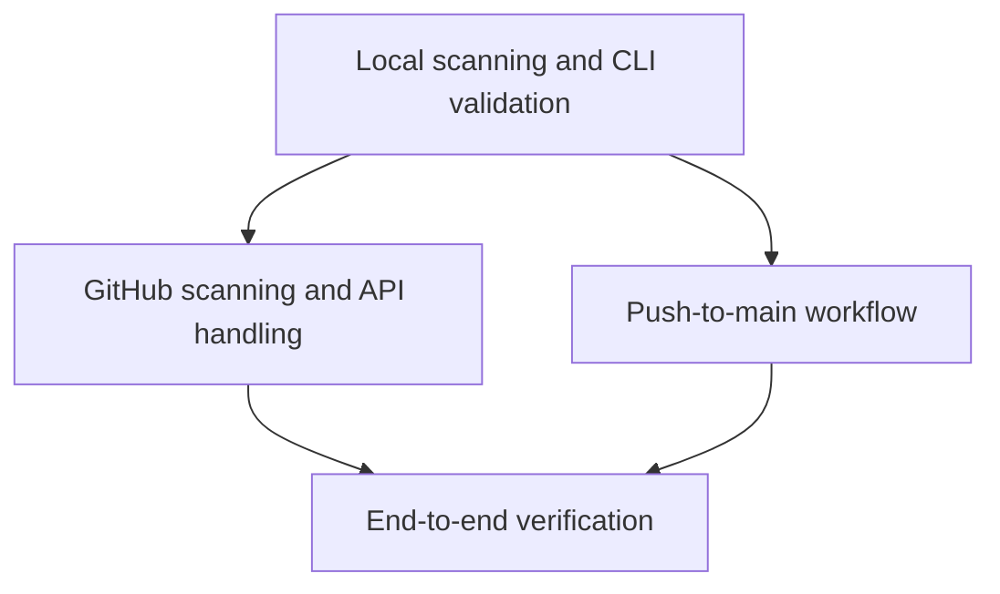

# Implementation Plan

## 1. Summary

Implement the approved repository documentation generator in dependency
order. Each task includes focused tests for the behavior it introduces.

## 2. Tasks

| ID | Task | Requirements | Depends on |
| --- | --- | --- | --- |
| T1 | Complete deterministic local scanning and CLI validation | FR-1, FR-3 to FR-8, FR-9, FR-12 to FR-13, NFR-1 to NFR-4 | None |
| T2 | Add GitHub repository scanning and API error handling | FR-2, FR-3 to FR-7, FR-9 to FR-13, NFR-1, NFR-3 | T1 |
| T3 | Add the push-to-main documentation workflow | FR-14 | T1 |
| T4 | Verify end-to-end acceptance and update generated documentation | AC1 to AC8 | T2, T3 |

## 3. Task Details

### T1: Complete deterministic local scanning and CLI validation

Implement the approved README summary, `requirements.txt`-only dependency,
common/declared entry-point, and `Not Found` rules for local repositories.
Validate that the input path exists and is a directory. Empty directories
must produce seven `Not Found` section values; invalid paths must fail
clearly. Exclude common generated/dependency directories from recursive
language scans, keep output independent of absolute paths, and sanitize
recognized secrets before rendering. Preserve explicit output-path support.

Tests shall cover the AC1 fixture, missing metadata, empty repository,
invalid paths, deterministic repeated output, generated-directory exclusion,
and representative secret-like input.

### T2: Add GitHub repository scanning and API error handling

Accept a validated GitHub `owner/name`, fetch repository facts and relevant
files through the GitHub API using bounded requests, and render them through
the same document format. Read an optional token only from its environment
variable. Default remote output to `docs/PROJECT_DOC.md` under the current
working directory; preserve an explicit output override. Return clear,
sanitized non-zero failures for missing repositories, rate limits, timeouts,
HTTP failures, and malformed responses.

Tests shall mock API success, missing repositories, rate limits, timeout,
malformed responses, token use, and default/explicit output destinations.
No test shall require a live repository or credential.

### T3: Add the push-to-main documentation workflow

Add a dedicated GitHub Actions workflow for pushes to `main`. It shall set
up Python 3.11, install declared dependencies, run local mode on the checked
out repository, and commit `docs/PROJECT_DOC.md` only when it changed. Give
the job only the permissions needed to push the generated update and avoid
exposing token material in logs.

Validate the workflow structure and the no-change commit condition.

### T4: Verify end-to-end acceptance and update generated documentation

Run the relevant tests and the complete pytest suite. Exercise local CLI
success, empty repository, and invalid path behavior; verify GitHub behavior
using mocks. Regenerate this repository's `docs/PROJECT_DOC.md`, check the
seven section order, missing-value spelling, determinism, and absence of
absolute paths or representative secrets. Record test evidence in the
existing verification artifact only if that file is part of the task scope.

## 4. Dependency Order

## 5. Definition of Done

- The seven required sections are always present in the correct order.
- Missing values are exactly `Not Found`; empty repos are non-crashing.
- Invalid inputs and GitHub failures produce clear, sanitized non-zero
  results.
- Generated output is deterministic and contains no absolute local paths or
  recognized secrets.
- The GitHub Action runs on pushes to `main` and commits only changed output.
- Focused tests and the full pytest suite pass.
