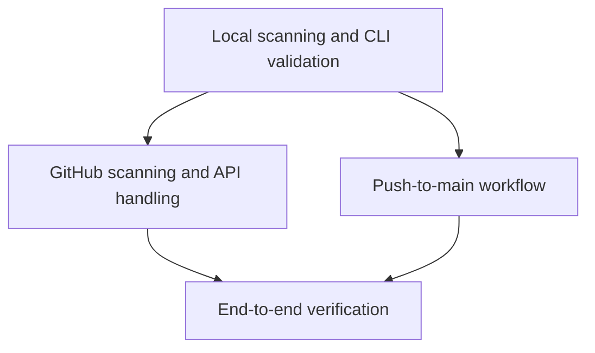
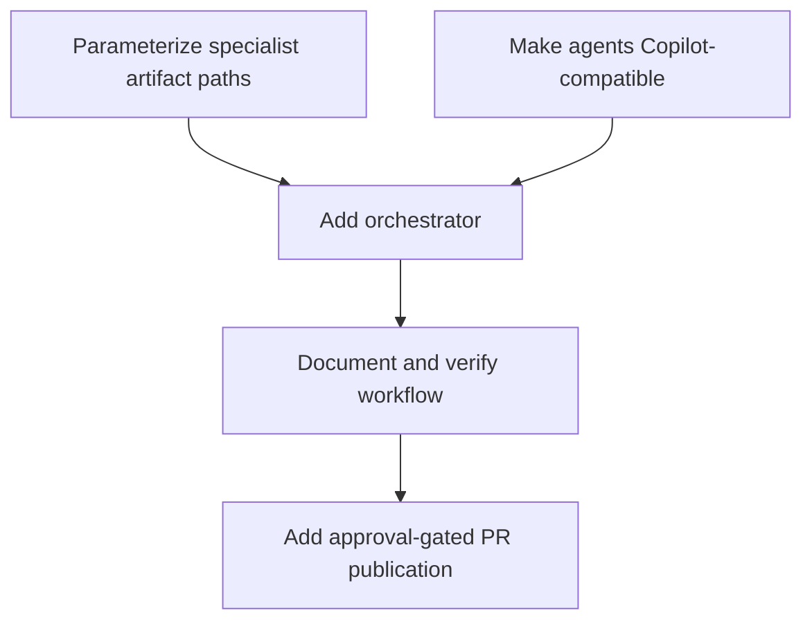

# Implementation Plan

## 1. Summary

Implement the approved repository documentation generator in dependency
order. Each task includes focused tests for the behavior it introduces.

## 2. Tasks

| ID | Task | Requirements | Depends on |
| --- | --- | --- | --- |
| T1 | Complete deterministic local scanning and CLI validation | FR-1, FR-3 to FR-8, FR-9, FR-12 to FR-13, NFR-1 to NFR-4 | None |
| T2 | Add GitHub repository scanning and API error handling | FR-2, FR-3 to FR-7, FR-9 to FR-13, NFR-1, NFR-3 | T1 |
| T3 | Add the push-to-main documentation workflow | FR-14 | T1 |
| T4 | Verify end-to-end acceptance and update generated documentation | AC1 to AC8 | T2, T3 |

## 3. Task Details

### T1: Complete deterministic local scanning and CLI validation

Implement the approved README summary, `requirements.txt`-only dependency,
common/declared entry-point, and `Not Found` rules for local repositories.
Validate that the input path exists and is a directory. Empty directories
must produce seven `Not Found` section values; invalid paths must fail
clearly. Exclude common generated/dependency directories from recursive
language scans, keep output independent of absolute paths, and sanitize
recognized secrets before rendering. Preserve explicit output-path support.

Tests shall cover the AC1 fixture, missing metadata, empty repository,
invalid paths, deterministic repeated output, generated-directory exclusion,
and representative secret-like input.

### T2: Add GitHub repository scanning and API error handling

Accept a validated GitHub `owner/name`, fetch repository facts and relevant
files through the GitHub API using bounded requests, and render them through
the same document format. Read an optional token only from its environment
variable. Default remote output to `docs/PROJECT_DOC.md` under the current
working directory; preserve an explicit output override. Return clear,
sanitized non-zero failures for missing repositories, rate limits, timeouts,
HTTP failures, and malformed responses.

Tests shall mock API success, missing repositories, rate limits, timeout,
malformed responses, token use, and default/explicit output destinations.
No test shall require a live repository or credential.

### T3: Add the push-to-main documentation workflow

Add a dedicated GitHub Actions workflow for pushes to `main`. It shall set
up Python 3.11, install declared dependencies, run local mode on the checked
out repository, and commit `docs/PROJECT_DOC.md` only when it changed. Give
the job only the permissions needed to push the generated update and avoid
exposing token material in logs.

Validate the workflow structure and the no-change commit condition.

### T4: Verify end-to-end acceptance and update generated documentation

Run the relevant tests and the complete pytest suite. Exercise local CLI
success, empty repository, and invalid path behavior; verify GitHub behavior
using mocks. Regenerate this repository's `docs/PROJECT_DOC.md`, check the
seven section order, missing-value spelling, determinism, and absence of
absolute paths or representative secrets. Record test evidence in the
existing verification artifact only if that file is part of the task scope.

## 4. Dependency Order

## 5. Definition of Done

- The seven required sections are always present in the correct order.
- Missing values are exactly `Not Found`; empty repos are non-crashing.
- Invalid inputs and GitHub failures produce clear, sanitized non-zero
  results.
- Generated output is deterministic and contains no absolute local paths or
  recognized secrets.
- The GitHub Action runs on pushes to `main` and commits only changed output.
- Focused tests and the full pytest suite pass.

## 6. Agent Orchestrator Tasks

| ID | Task | Priority | Requirements | Blocked by | Status |
| --- | --- | --- | --- | --- | --- |
| AO-1 | Parameterize specialist artifact paths | P1 | FR-17, FR-18, FR-23, FR-24, NFR-5, NFR-6 | None | Done |
| AO-2 | Make specialist agents Copilot-compatible | P1 | FR-16, NFR-5 | None | Done |
| AO-3 | Add the Copilot orchestrator and launch prompt | P1 | FR-15 to FR-24, NFR-5 to NFR-7 | AO-1, AO-2 | Done |
| AO-4 | Document and verify the orchestrated workflow | P1 | AC9 to AC15 | AO-3 | Done (runtime smoke test unavailable) |
| AO-5 | Add approval-gated commit, push, and PR creation/update stage | P1 | FR-20 to FR-27, AC16 to AC18 | AO-3, AO-4 | Done (runtime smoke test unavailable) |

### AO-1: Parameterize specialist artifact paths

**Description:** Update the existing analyst, architect, planner, developer,
reviewer, and tester instructions and their related prompt files to accept a
workflow artifact directory. Keep the existing shared `docs/` defaults for
manual use, but ensure orchestrated runs read and write only within the
provided workflow directory, except for source-code changes required by the
implementation task.

**Acceptance criteria:**
- Each relevant stage prompt identifies its input artifacts and output path
  under the supplied workflow directory.
- Reviewer findings remain read-only until the orchestrator records the
  user's decisions.
- Manual use without a workflow directory retains the existing shared-docs
  behavior.

**Tests needed:** Inspect each changed prompt's input/output paths and check
that existing pytest behavior remains unchanged.

### AO-2: Make specialist agents Copilot-compatible

**Description:** Update the specialist agent tool declarations to use tools
supported by the Copilot harness. Preserve each role's permissions: reviewers
remain read-only, while stages that write artifacts or implementation code
retain only the required editing and command capabilities.

**Acceptance criteria:**
- No specialist depends on unsupported tool names such as `editFiles` or
  `runCommands`.
- Each agent has only the Copilot-supported tools needed for its role.
- External tool access is not broadened and no credentials are added to files.

**Tests needed:** Check the agent frontmatter against the current Copilot
custom-agent schema and confirm that all retained MCP tool references are
available in the workspace.

### AO-3: Add the Copilot orchestrator and launch prompt

**Description:** Add a workspace orchestrator agent and a prompt that accepts
both a user story and requirement text. Generate a unique sanitized workflow
directory, then delegate analyst, architect, design reviewer, planner,
developer, code reviewer, and tester stages sequentially. Pass the correct
named artifacts to each stage, collect user decisions before writes and
implementation tasks, process all plan tasks one at a time in dependency
order, and stop on missing outputs or failures.

**Acceptance criteria:**
- The coordinator uses Copilot-native agent delegation, not Local-only
  handoff configuration.
- Each stage receives the workflow directory and required prior artifacts.
- All artifacts are isolated in the current run's directory.
- File writes, review decisions, and each developer task retain their
  required approval checkpoints.
- A failed stage, unresolved review, missing artifact, or incomplete blocker
  prevents downstream delegation and is reported clearly.

**Tests needed:** Exercise a successful multi-stage handoff and a missing
artifact/failure stop scenario in the target Copilot harness.

### AO-4: Document and verify the orchestrated workflow

**Description:** Document how to launch the workflow with the story and
requirement inputs. Validate the workspace agent configuration, handoff
sequence, artifact isolation, approval checkpoints, and failure handling.

**Acceptance criteria:**
- README instructions identify the orchestrator and required inputs.
- A VS Code Copilot smoke test confirms outputs are passed to downstream
  agents without manual re-entry.
- A second run uses a different artifact directory and does not overwrite the
  first run or project-level docs.
- The complete pytest suite passes.

**Tests needed:** Run `pytest` and execute the two Copilot smoke scenarios
above. Record runtime limitations if the target VS Code harness is
unavailable.

**Validation evidence:** `pytest` passed (36 tests). Static checks confirmed
the orchestrator prompt inputs, Copilot target/tool declarations, and absence
of legacy specialist tool names. `git diff --check` passed with CRLF-aware
whitespace handling. A live VS Code Copilot smoke test was not run because
desktop access was not enabled.

### AO-5: Add approval-gated commit, push, and PR creation/update stage

**Description:** Extend the orchestrator to invoke the PR writer only after
successful verification. Make the PR writer prepare the required PR
description from actual changed files and test results, then require explicit
user approval before writing PR metadata, committing approved changes,
pushing the non-base branch, and creating or updating the pull request.
Update a matching open PR when available; otherwise create one against
`main`. Stop on failed verification, missing authentication/remote, the base
branch being checked out, or unapproved work. Never merge automatically.

**Acceptance criteria:**
- The orchestration sequence ends with tester verification followed by the
  PR writer; failed verification prevents publication.
- The PR description contains Summary, Changes Made, Test Evidence,
  Known Limitations, and Reviewer Checklist, with no invented facts.
- The user approves PR-description/CHANGELOG writes and each external
  publication action before it occurs.
- Only approved changes on a non-base branch can be committed and pushed.
- A matching open PR is updated rather than duplicated; otherwise a PR is
  created against `main`; no PR is merged.
- The PR URL and publication result are returned to the user.

**Tests needed:** Static checks for the final-stage ordering, required
approval and safety guards, required PR sections, update-or-create behavior,
and absence of merge actions. Runtime validation must confirm that the target
Copilot harness can invoke the PR writer and that `gh` authentication works.

**Validation evidence:** Static checks confirmed that the orchestrator invokes
the PR writer only after successful verification, the PR prompt requires the
five specified sections and distinct approvals for commit, push, and PR
creation/update, the PR writer handles a matching open PR before creating a
new one, and no merge action is specified. `git diff --check` passed. A live
Copilot delegation and GitHub publication smoke test was not run.

### Agent Orchestrator Dependency Order

### Agent Orchestrator Definition of Done

- Every workflow run has its own unique, sanitized artifact directory.
- Copilot receives each stage's named outputs as the next stage's inputs.
- Required approvals, dependency checks, and stop-on-failure behavior are
  preserved.
- Existing specialist responsibilities and doc-sync CLI behavior are
  unchanged.
- VS Code Copilot smoke tests and the existing pytest suite pass, or any
  harness limitation is reported explicitly.
- After successful verification and explicit approval, the PR stage commits
  and pushes only approved work, then creates or updates a PR without merging.
