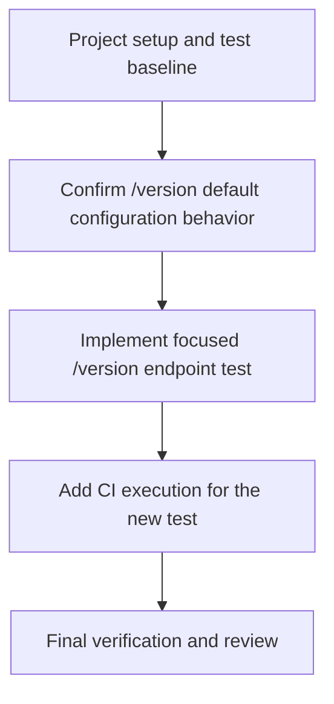

# Implementation Plan

## 1. Task Summary
Total tasks: 5

Build order: start with project setup, then the core FastAPI test contract work, then CI validation, and finally final review and completion checks.

## 2. Task List

| ID | Title | Priority | Requirements | Blocked by | Status |
| --- | --- | --- | --- | --- | --- |
| T1 | Project setup and test baseline | High | FR-1, FR-6, NFR-3, NFR-4 | None | To Do |
| T2 | Confirm /version default configuration behavior | High | FR-2, FR-5 | T1 | To Do |
| T3 | Implement focused /version endpoint test | High | FR-1, FR-3, FR-4, FR-5, NFR-2 | T2 | To Do |
| T4 | Add CI execution for the new test | Medium | FR-6, NFR-2 | T3 | To Do |
| T5 | Final verification and review | Medium | NFR-1, NFR-4, Definition of Done | T4 | To Do |

## 3. Task Details

### T1: Project setup and test baseline
Description: Confirm the existing FastAPI project and test infrastructure are ready for a focused endpoint test. Ensure the test environment can run the app in-process without additional services or secrets.

Acceptance criteria:
- The project has a working test runner for the FastAPI app.
- The environment is ready for a targeted endpoint test.
- No secrets are required for the test flow.

Tests needed:
- Existing endpoint tests still run successfully.
- Baseline test command confirms the project is in a valid state.

### T2: Confirm /version default configuration behavior
Description: Validate the expected default configuration contract for the app when APP_ENV and APP_REGION are unset. This ensures the test exercises the intended default path before writing assertions.

Acceptance criteria:
- The application can be created/imported with APP_ENV and APP_REGION unset.
- The default values are identified as environment = "development" and region = "local".
- The environment is restored after validation to avoid cross-test leakage.

Tests needed:
- A focused sanity check or test fixture that confirms the default values before final assertion coverage is added.

### T3: Implement focused /version endpoint test
Description: Add one endpoint test that calls GET /version with APP_ENV and APP_REGION unset, asserts HTTP 200, and validates the JSON response contract exactly.

Acceptance criteria:
- The test clears APP_ENV and APP_REGION before app creation/import.
- The test restores those variables after execution.
- The response status is 200.
- The JSON contains version, environment, and region.
- environment equals "development" and region equals "local".
- The payload structure is checked strictly to avoid false positives.

Tests needed:
- pytest test for GET /version default contract.
- Optional negative assertion for malformed or missing payload keys if supported by the test framework.

### T4: Add CI execution for the new test
Description: Ensure the new /version contract test runs in the normal CI pipeline so regressions are caught early.

Acceptance criteria:
- The new test is part of the standard automated validation path.
- CI runs the test without secrets or special setup.
- Failures surface clearly in the result logs.

Tests needed:
- CI validation run or local equivalent of the project test command.
- Review of the test output to confirm the test is executed and reported.

### T5: Final verification and review
Description: Validate the change is complete, narrow in scope, and consistent with the requirements and design review decisions.

Acceptance criteria:
- All relevant tests pass.
- No secrets are introduced or required.
- The implementation follows the project requirements and accepted architecture decisions.
- The fix is reviewed for scope and clarity.

Tests needed:
- Final project test run.
- Review of the updated files against requirements and design review decisions.

## 4. Dependency Order

## 5. Blocked Tasks

- T2 is blocked by T1 because the test environment and project baseline must exist before default configuration behavior can be validated.
- T3 is blocked by T2 because the exact default contract must be confirmed before final assertions are implemented.
- T4 is blocked by T3 because the test must exist before it can be integrated into CI.
- T5 is blocked by T4 because the final check happens after the test is running in the standard validation path.

## 6. Definition of Done
- All required tests pass.
- APP_ENV and APP_REGION are cleared before test app creation/import and restored afterward to validate default configuration behavior.
- The /version endpoint test asserts HTTP 200 and the exact JSON contract for version, environment, and region.
- The implementation uses no secrets and does not print environment values in logs.
- The work matches the accepted architecture findings and does not broaden scope beyond the story.
- Requirements, architecture, and design review are all consistent.
- Final review is complete and no unresolved items remain.
